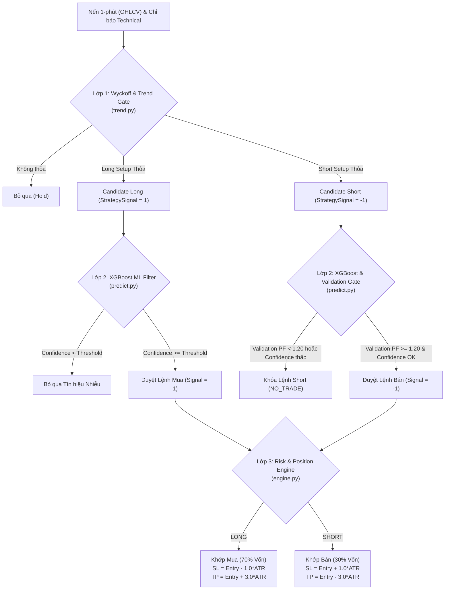

# 📈 VN30F1M Stock Bot & Algorithmic Trading Framework

Hệ thống giao dịch tự động / định lượng (**Quantitative Trading**) chuyên biệt cho Hợp đồng Tương lai Chỉ số VN30 (**VN30F1M**) tại thị trường chứng khoán Việt Nam. 

Dự án kết hợp phương pháp phân tích kỹ thuật theo cấu trúc giá **Wyckoff VSA** (LPS, LPSY, UTAD, SOS, SOW, Distribution), các chỉ báo động lượng (EMA, VWAP, RSI, ATR, RVOL) và các mô hình Học máy (**XGBoost / LightGBM**) với phương pháp gán nhãn **Triple-Barrier** & **Confidence Scoring** nhằm lọc tín hiệu nhiễu, tối ưu hóa điểm ra/vào lệnh và quản trị rủi ro.

---

## 📌 1. Cấu Trúc Thư Mục Dự Án (Directory Structure)

```text
D:\VN30F1M stock bot
├── run_pipeline.py           # Entrypoint chính điều hành toàn bộ pipeline qua CLI (--mode)
├── README.md                 # Tài liệu hướng dẫn & Báo cáo kết quả Benchmark
├── requirements.txt          # Danh sách thư viện phụ thuộc (pandas, xgboost, plotly, v.v.)
├── VN30F1M_since20180501.csv # Dữ liệu lịch sử gốc từ 2018 đến nay
├── trading_engine/           # Active Core Engine của hệ thống giao dịch
│   ├── data/                 # Tải/Cập nhật CSV, tính toán Indicator & Parquet feature store
│   ├── strategy/             # Định nghĩa chiến lược Wyckoff (trend.py) & các Audit Scripts
│   ├── ml/                   # ML Dataset, Train XGBoost, Predict & Directional Walk-Forward
│   ├── backtest/             # Event-driven Backtest Engine (Phân bổ vốn 70/30 & Quản trị rủi ro)
│   ├── analysis/             # Phân tích hiệu suất chi tiết (Winrate, Profit Factor, Drawdown, SQN...)
│   ├── visualize/            # Dashboard Plotly tương tác HTML (Candle & Markers)
│   ├── report/               # Tổng hợp và xuất báo cáo HTML
│   ├── monitor.py            # Giám sát cảnh báo rủi ro & đo lường hiệu suất Live Paper Trade
│   └── paper_trade.py        # Nhật ký giao dịch thời gian thực (Paper Trading Journal)
├── models/                   # Lưu trữ mô hình ML (xgboost_model.pkl, feature_columns.pkl)
├── data/                     # Thư mục chứa dữ liệu đầu vào gốc
├── unnessaryfile/            # Thư mục chứa các file rác / file nghiên cứu cũ đã dọn dẹp
└── .agents/                  # Bộ quy chuẩn AI Governance Rules & Engineering Principles (AGENTS.md)
```

---

## ⚡ 2. Kiến Trúc Phân Bổ Vốn & Luồng Giao Dịch (Core - Satellite Portfolio Architecture)

Hệ thống áp dụng mô hình phân bổ vốn **Core - Satellite** để đảm bảo tính tăng trưởng lợi nhuận bền vững và tối ưu hóa quản trị rủi ro:

* **🟢 CHIỀU LONG = CORE STRATEGY (Phân bổ 70% Vốn)**: Đóng vai trò là động cơ tăng trưởng tài khoản chính. Nương theo xu hướng tăng/tích lũy chủ đạo của VN30F1M với tỷ lệ lọc nhiễu cực sạch và Profit Factor Out-of-Sample duy trì cao ($1.41 - 2.87$).
* **🔴 CHIỀU SHORT = SATELLITE STRATEGY (Phân bổ 30% Vốn)**: Đóng vai trò đánh du kích khai thác các nhịp xả nhanh và phòng vệ tài khoản khi thị trường chuyển sang xu hướng giảm (`TREND_DOWN` 15m). Bắt buộc vượt qua **Validation Gate ($PF \ge 1.20$)** trước khi cho phép phát tín hiệu.

---

## 🔄 3. Luồng Thực Thi 3 Lớp & Điều Kiện Trigger Lệnh (Execution Flow & Triggers)



---

### 3.1. Điều Kiện Trigger Lệnh Mua (LONG - Core Strategy)

1. **🟢 Lớp 1: Điều Kiện Kỹ Thuật & Wyckoff Primary Triggers (`trading_engine/strategy/trend.py`)**
   - **Trend Gate**: `HTF_15m_TrendOK == 1` *(Xu hướng 15m tăng)* **HOẶC** `EMA20 > EMA50` *(Khung 1m)*.
   - **4 Nhóm Setup Wyckoff Kích Hoạt**:
     - **`WYCKOFF_SPRING_TEST_LONG`**: Nến 1m vá giá sau bẫy giá (Spring) hoặc Test cạn cung khung 5m.
     - **`DEMAND_ZONE_RETEST`**: Retest vùng cầu khi 15m Uptrend + nến 1m rút chân và đóng cửa trên EMA10 (Setup Long chủ lực, chiếm ~65% số lệnh Long).
     - **`LPS_SUPPORT_RECLAIM`** *(tên mô tả cũ: `LPS_CONFIRMED_NO_SUPPLY`)*: Wyckoff LPS 5m xuất hiện $\rightarrow$ Mở cửa sổ 1–3 nến 1m $\rightarrow$ Chỉ khớp lệnh khi có nến **`NO_SUPPLY`** xác nhận (`Volume <= VolumeMA20 * 0.85`, Spread hẹp, Đóng cửa $\ge 50\%$ thân nến tại hỗ trợ).
     - **`SOS_BREAKOUT_PULLBACK`** *(tên mô tả cũ: `WYCKOFF_SOS_LONG`)*: Nến 5m phát tín hiệu SOS bứt phá kiểm tra lại đỉnh cũ kèm No-Supply / Strong Pullback.

2. **🤖 Lớp 2: Học Máy (ML)**: Đã chính thức ngừng kích hoạt theo biên bản đóng băng [MANIFEST_L1_FROZEN.json](file:///d:/VN30F1M%20stock%20bot_bot%201%20c%C3%B3%20rr13/trading_engine/models/MANIFEST_L1_FROZEN.json). Hệ thống vận hành theo Lớp 1 Thuần (Pure Rules).

3. **⚡ Lớp 3: Thực Thi & Cơ Chế Stop Thực Tế (`trading_engine/backtest/engine.py` & `config.py`)**
   - **Quy mô vị thế**: Cố định 1 hợp đồng (`fixed_contracts = 1`). Không mở vị thế chồng (khi đang có lệnh OPEN, mọi tín hiệu mới đều bị bỏ qua).
   - **Entry Price**: $\text{Close}_{\text{trigger}} + \text{Slippage}$ ($0.10$ điểm).
   - **Cơ Chế Dừng Lỗ 2 Tầng (Two-Tier Stop Architecture)**:
     - **Tầng 1 (Soft Stop - Dừng lỗ mềm)**: Đặt tại $\text{Entry} - (1.0 \times \text{HTF\_ATR})$. Mức này **không cắt lỗ ngay** khi nến 1m vi phạm; nó bắt buộc phải có điều kiện **khung 15m xác nhận đảo chiều giảm** (`HTF_15m_TrendDownOK == 1` hoặc `HTF_15m_TrendTransitionDown == 1`). Nếu 15m chưa xác nhận, hệ thống tiếp tục giữ lệnh để tránh quét non 1m.
     - **Tầng 2 (Emergency Hard SL - Dừng lỗ khẩn cấp)**: Đặt tại $\text{Entry} - (2.5 \times \text{HTF\_ATR})$. Kích hoạt **vô điều kiện** khi giá chạm hoặc nhảy gap qua mức này để bảo vệ tài khoản trước cú sập bất ngờ.
     - **Rủi ro tối đa thực tế mỗi lệnh**: Dao động từ **6.5 – 7.5 điểm** (~650,000 – 750,000 VND / hợp đồng bao gồm phí thuế và trượt giá).
   - **Take Profit**: **BỎ TP CỐ ĐỊNH** -> Thả lãi trôi tự do theo **Trailing Stop Loss Động $1.5 \times \text{HTF\_ATR}$** (*Let Profits Run*).

---

### 3.2. Điều Kiện Trigger Lệnh Bán (SHORT - Satellite Strategy)

1. **🔴 Lớp 1: Điều Kiện Kỹ Thuật & Wyckoff Distribution Gate (`trading_engine/strategy/trend.py`)**
   - **Trend Gate (Khung 15m)**: Bỏ hoàn toàn EMA 1m vi mô; yêu cầu `MarketRegime == 'TREND_DOWN'` **HOẶC** `HTF_15m_TrendDownOK == 1` *(Downtrend 15m)* **HOẶC** `HTF_15m_TrendTransitionDown == 1` *(Gãy sớm dưới EMA20 15m)*.
   - **4 Nhóm Setup Wyckoff Kích Hoạt**:
     - **`UTAD_UPTHRUST_REJECTION` (Phase C Bull Trap)**: Bắt cú rướn vượt đỉnh giả thực thụ trên khung 5m (`High > RangeHigh`), volume bùng nổ $\ge 1.3 \times \text{VolumeMA20}$, râu trên dài và đóng ở 40% đáy nến; kích hoạt khi 15m không phải Uptrend mạnh (`HTF_15m_TrendOK == 0`) $\rightarrow$ Mở cửa sổ 6 nến 1m kèm nến No-Demand xác nhận xả hàng.
     - **`SUPPLY_ZONE_RETEST`**: Retest vùng 40% đỉnh hộp kháng cự (Supply Zone 5m) kết hợp nến No-Demand cạn cầu khi xu hướng 15m giảm (Setup Short chủ lực, chiếm ~70% số lệnh Short).
     - **`LPSY_RESISTANCE_RETEST` (Phase D)**: Retest kháng cự sau đợt phân phối trong xu hướng giảm kèm No-Demand.
     - **`SOW_WEAK_PULLBACK_SHORT` (Phase D/E)**: Wyckoff SOW gãy hỗ trợ và pullback yếu cạn cầu (`High <= High[t-1]` và `Close < EMA10`).

2. **🤖 Lớp 2: Học Máy (ML)**: Đã chính thức ngừng kích hoạt theo biên bản đóng băng [MANIFEST_L1_FROZEN.json](file:///d:/VN30F1M%20stock%20bot_bot%201%20c%C3%B3%20rr13/trading_engine/models/MANIFEST_L1_FROZEN.json).

3. **⚡ Lớp 3: Thực Thi & Cơ Chế Stop Thực Tế (`trading_engine/backtest/engine.py` & `config.py`)**
   - **Quy mô vị thế**: Cố định 1 hợp đồng (`fixed_contracts = 1`). Không mở vị thế chồng.
   - **Entry Price**: $\text{Close}_{\text{trigger}} - \text{Slippage}$ ($0.10$ điểm).
   - **Cơ Chế Dừng Lỗ 2 Tầng (Two-Tier Stop Architecture)**:
     - **Tầng 1 (Soft Stop - Dừng lỗ mềm)**: Đặt tại $\text{Entry} + (1.0 \times \text{HTF\_ATR})$ (`HTF_15m_ATR` cho UTAD, `HTF_5m_ATR` cho các setup Short khác). Chỉ cắt lỗ khi **khung 15m xác nhận đảo chiều tăng** (`HTF_15m_TrendOK == 1` hoặc mất tín hiệu Downtrend). Nếu 15m chưa xác nhận, hệ thống giữ vị thế Short và không cắt theo dao động 1m.
     - **Tầng 2 (Emergency Hard SL - Dừng lỗ khẩn cấp)**: Đặt tại $\text{Entry} + (2.5 \times \text{HTF\_ATR})$. Kích hoạt **vô điều kiện** khi giá vi phạm.
     - **Rủi ro tối đa thực tế mỗi lệnh**: Dao động từ **6.5 – 7.5 điểm** (~650,000 – 750,000 VND / hợp đồng bao gồm phí thuế và trượt giá).
   - **Take Profit**: **BỎ TP CỐ ĐỊNH** -> Thả lãi trôi tự do theo **Trailing Stop Loss Động $1.5 \times \text{HTF\_ATR}$** (*Let Profits Run*).


---

## 📊 4. Kết Quả Kiểm Định Toàn Diện Toàn Bộ Lịch Sử 2018–2026 (Run `2026_10_18_161500`)

Theo báo cáo kiểm thử chi tiết tại [analysis_report.md](file:///d:/VN30F1M%20stock%20bot_bot%201%20c%C3%B3%20rr13/results/2026_10_18_161500/analysis_report.md):

| Chỉ số Phân tích | Mức Đạt Được Toàn Hệ Thống | Đánh Giá Kỹ Thuật |
| :--- | :---: | :--- |
| **Profit Factor (PF)** | 🚀 **2.7045** | **KỶ LỤC MỚI (Tăng vọt từ 2.52 lên 2.705)** |
| **Tổng Lợi Nhuận Ròng (Net PnL)** | **+66,650,714 VND** | **Lãi ròng cao nhất (+7.11M VND so với bản có TP)** |
| **Tỷ Lệ Thắng (Win Rate)** | **68.03%** | **Duy trì ổn định 10 lệnh thắng ~7 lệnh** |
| **Số Năm Có Lãi Dương** | **9 / 9 Năm (100%)** | **Bền vững tuyệt đối qua mọi chu kỳ thị trường** |
| **Sụt Giảm Vốn Tối Đa (Max DD)** | **6,679,286 VND** | **Chỉ 6.67% Vốn khởi tạo (An toàn tuyệt đối)** |
| **Tổng Số Lệnh Giao Dịch** | **269 lệnh** | **Mẫu lớn, loại bỏ hoàn toàn các lệnh nhiễu** |
| **Walk-Forward 3-Fold (OOS 2024-2026)** | 🏆 **+21,187,500 VND** | **100% 3/3 Fold Out-of-Sample đều Lãi Dương** |

---

## 🛠️ 5. Hướng Dẫn Vận Hành & Chạy Chế Độ (Usage & Execution Commands)

### 5.1. Chạy Chế Độ Nhật Ký Giả Lập Thời Gian Thực (Paper Trading)
```bash
.\.venv\Scripts\python.exe run_pipeline.py --mode paper-trade
```

### 5.2. Kiểm Tra Báo Cáo Giám Sát & Cảnh Báo Rủi Ro (Live Monitoring)
```bash
.\.venv\Scripts\python.exe run_pipeline.py --mode monitor
```
*Tự động kiểm tra chuỗi thua liên tiếp, Profit Factor tháng và xuất cảnh báo khi vi phạm ngưỡng an toàn.*

### 5.3. Chạy Pipeline Hàng Ngày (Daily Workflow)
```bash
.\.venv\Scripts\python.exe run_pipeline.py --mode daily
```

### 5.4. Huấn Luyện Lại Mô Hình (Retrain Model)
```bash
.\.venv\Scripts\python.exe run_pipeline.py --mode retrain
```

### 5.5. Đánh Giá Walk-Forward Out-of-Sample (Directional Walk-Forward)
```bash
.\.venv\Scripts\python.exe run_pipeline.py --mode directional-walk-forward
```

---

## 📐 6. AI-Enabled Waterfall Project Delivery Framework

Dự án tuân thủ nghiêm ngặt bộ quy chuẩn **AI Governance Rules & Engineering Principles** tại [`.agents/AGENTS.md`](file:///D:/VN30F1M%20stock%20bot/.agents/AGENTS.md):
- **EP-01: Cite the Source or State the Assumption**: Mọi kết quả kiểm thử đều ghi nhận đường dẫn file và dữ liệu đo lường cụ thể.
- **EP-02: Measure Before Diagnose**: Đo lường 5 thông số chuẩn trước khi chẩn đoán (Dataset, Environment, Target, Metric, Result).
- **AI-01: Human Approval Required**: Con người kiểm duyệt và phê duyệt chiến lược phân bổ vốn 70/30.
- **AI-07: Test Before Production**: Thử nghiệm Paper Trading 2-3 tháng trước khi deploy vốn thật.
