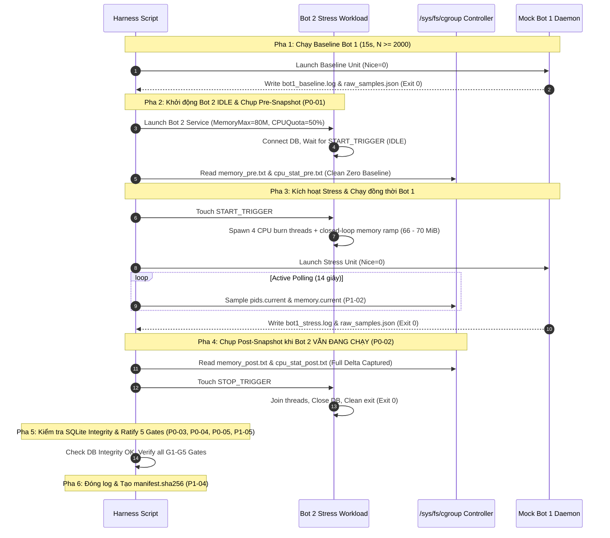

# P40-DOC-07: STAGE 40.1 LINUX NATIVE VERIFICATION PROTOCOL & RATIFICATION REPORT

- **Project:** `REGIME-ROUTER-02` (VN30F1M Futures)
- **Reference:** `P40-DOC-07-LINUX-VERIF` (v2.3 - Fail-Closed Staging Execution Protocol)
- **Phase:** Phase 40 — Stage 40.1 (Linux Resource Isolation Verification)
- **Status:** `REMEDIATED v2.3 — READY FOR CODE REVIEW & STAGING RUN`
- **Execution Target:** Independent Linux Staging VM (Zero Touch Production VPS)
- **Harness Script:** [tests/paper/linux_stage_40_1_cgroup_verify.sh](file:///d:/VN30F1M%20stock%20bot_bot%201%20c%C3%B3%20rr13/tests/paper/linux_stage_40_1_cgroup_verify.sh)
- **Timestamp:** 2026-11-23T22:45:00+07:00

---

## 1. NGUYÊN TẮC VẬN HÀNH & TRIẾT LÝ KIỂM THỬ FAIL-CLOSED

Theo chỉ thị cốt lõi của Tech Lead:
> *"Tôi không muốn chúng ta có một Harness chuyên tạo ra những dòng chữ PASS. Tôi muốn một Harness mà khi Bot 2 không chạy, cgroup không tồn tại, memory không được kiểm soát hoặc Bot 1 bị ảnh hưởng, nó phải tự phát hiện và báo FAIL."*
> *"Nếu một gate không đạt, Stage 40.1 chưa được nghiệm thu. Không được lấy PASS của bốn gate còn lại để bù cho gate thất bại."*

### Kỷ luật an toàn tuyệt đối:
1. **Zero Touch Production VPS:** Giữ nguyên 100% VPS Oracle Cloud (`instance-20261114-1044`, PID `139407`). Không mở SSH, không ghi file, không truy cập database của Bot 1 thật.
2. **Zero Broker API & Streaming:** Không kết nối tài khoản chứng khoán, không đặt lệnh thật, không mở WebSocket streaming.
3. **Môi trường thực thi:** Chỉ chạy trên Linux Staging VM độc lập có nhân Linux hỗ trợ Cgroup v2 unified hierarchy và systemd active.

---

## 2. MA TRẬN 10 ĐIỂM SỬA ĐỔI TOÀN DIỆN TRONG HARNESS V2.3

| Mã lỗi | Hạng mục khắc phục | Trạng thái trước (v2.2) | Cải tiến triệt để trong v2.3 | Mức độ |
| :---: | :--- | :--- | :--- | :---: |
| **P0-01** | **Thời điểm lấy snapshot Memory** | Khởi động Bot 2 chạy ngay tải $\to$ `high events` có thể tăng trước khi chụp `memory_pre.txt` $\to$ $\Delta \text{high}=0$ gây false FAIL. | Khởi động Bot 2 ở trạng thái **IDLE**; chụp `memory_pre.txt` đầy đủ, sau đó mới phát `START_TRIGGER` để bắt đầu cấp phát. | **CRITICAL** |
| **P0-02** | **Vòng đời Bot 2 & Post-Snapshot** | Chạy `wait` đợi Bot 2 thoát $\to$ systemd xóa cgroup $\to$ post-snapshot đọc rỗng/NA. | Giữ Bot 2 hoạt động liên tục; chụp `memory_post.txt` & `cpu_stat_post.txt` **trong khi Bot 2 vẫn đang stress**, sau đó mới phát `STOP_TRIGGER`. | **CRITICAL** |
| **P0-03** | **Điều kiện Gate G2 (Memory)** | Chỉ kiểm tra $\Delta \text{high} > 0$ và $\Delta \text{oom\_kill} = 0$, bỏ qua max events, oom events và cấu hình quota. | Kiểm tra đồng thời: `memory.max=83886080`, `memory.high=68157440`, $\Delta \text{high} > 0$, $\Delta \text{max} = 0$, $\Delta \text{oom} = 0$, $\Delta \text{oom\_kill} = 0$, `swap = 0`, và $65\text{M} \le \text{peak} < 80\text{M}$. | **CRITICAL** |
| **P0-04** | **Điều kiện Gate G3 (CPU)** | Chỉ kiểm tra $\Delta \text{usage} > 0$ và $\Delta \text{throttled} > 0$, chưa xác nhận `cpu.max` và $\Delta \text{throttled\_usec}$. | Kiểm tra đồng thời: `cpu.max == '50000 100000'`, $\Delta \text{usage\_usec} > 0$, $\Delta \text{nr\_periods} > 0$, $\Delta \text{nr\_throttled} > 0$, $\Delta \text{throttled\_usec} > 0$. | **CRITICAL** |
| **P0-05** | **Loại bỏ Fail-Open trong Gate G5** | Hàm `get_metrics` trả về `{}` khi thiếu log $\to$ giá trị 0 $\to$ tự động PASS; dùng `|| true` che giấu lỗi exit. | Xóa bỏ toàn bộ `|| true`; kiểm tra `ExecMainStatus == 0`; nếu thiếu log metrics thì `sys.exit(FATAL)` $\to$ Gate G5 lập tức FAIL; yêu cầu $N \ge 2,000$ mẫu hợp lệ. | **CRITICAL** |
| **P1-01** | **Xác thực toàn diện Gate G1** | Chỉ kiểm tra `cgroup2fs`, tự in thông báo PASS. | Viết logic Python kiểm tra: Kernel $\ge 5.8$, systemd active, `cgroup.controllers` có đủ 3 controller `memory`, `cpu`, `pids`. Thiếu 1 tiêu chí $\to$ dừng script ngay lập tức. | **HIGH** |
| **P1-02** | **Xử lý lỗi đọc Tasks Polling** | Dùng `|| echo 0` che giấu khi cgroup unreadable. | Tách bạch giá trị đọc được với lỗi đọc; nếu file biến mất thì log `ERROR: cgroup files unreadable` và tăng `POLLING_ERROR_COUNT`. Gate G4 bắt buộc `POLLING_ERROR_COUNT == 0`. | **HIGH** |
| **P1-03** | **Chuẩn hóa Heartbeat Metrics** | Gọi `hb_jitter` chưa đúng nghĩa thống kê. | Đổi tên chuẩn: `heartbeat_max_lateness_s` ($\max(\text{interval}) - 0.500\text{s}$). Lưu median, p95, max interval và số lượng nhịp trễ quá 100ms. | **MEDIUM** |
| **P1-04** | **Thời điểm tạo Manifest SHA-256** | Tạo manifest khi `execution.log` vẫn đang ghi $\to$ sai lệch mã băm. | Đóng luồng log console (`exec 1>&- 2>&-`), sau đó mới quét toàn bộ tệp vật lý trong `OUTPUT_DIR` để tạo `manifest.sha256`. | **HIGH** |
| **P1-05** | **Kiểm toán SQLite Integrity** | Không kiểm tra tính toàn vẹn cơ sở dữ liệu. | Chạy `PRAGMA integrity_check;` trên cả Baseline DB và Stress DB; kiểm tra số bản ghi `bot1_state` $> 0$. Hỏng DB $\to$ Gate G5 FAIL. | **HIGH** |

---

## 3. QUY TRÌNH ĐỒNG BỘ LIFECYCLE BẰNG TRIGGER TRONG HARNESS V2.3

---

## 4. CHI TIẾT 5 GATES NGHIỆM THU (G1 - G5) TRONG MÃ NGUỒN V2.3

### Gate G1: Môi trường (Environment Verification)
- `Kernel Version` $\ge 5.8$ (kiểm tra qua `platform.release()`).
- Mount type `/sys/fs/cgroup` là `cgroup2fs`.
- Tồn tại file `cgroup.controllers` chứa đầy đủ 3 controller: `memory`, `cpu`, `pids`.
- `systemd` đang hoạt động bình thường.

### Gate G2: Cách ly bộ nhớ (Memory Isolation)
- `memory.max == 83886080` ($80.0\text{ MiB}$).
- `memory.high == 68157440` ($65.0\text{ MiB}$).
- `max_mem_observed` đạt từ $65.0\text{ MiB}$ đến $< 80.0\text{ MiB}$.
- $\Delta \text{high} > 0$ (Soft limit thực sự kích hoạt).
- $\Delta \text{max} == 0$ (Không chạm trần cứng).
- $\Delta \text{oom} == 0$ (Không kích hoạt OOM controller).
- $\Delta \text{oom\_kill} == 0$ (Không có tiến trình bị hủy).
- `memory.swap.current == 0` (Zero Swap).

### Gate G3: Cách ly CPU & Throttling (CPU Isolation)
- `cpu.max == "50000 100000"` ($50\%$ single core quota).
- $\Delta \text{usage\_usec} > 0$ (Chứng minh Bot 2 thực sự tiêu thụ CPU).
- $\Delta \text{nr\_periods} > 0$ (Các chu kỳ CFS $100\text{ ms}$ đã trôi qua).
- $\Delta \text{nr\_throttled} > 0$ (Kernel thực sự bóp xung nhịp Bot 2).
- $\Delta \text{throttled\_usec} > 0$ (Thời gian bị throttle được ghi nhận rõ ràng).

### Gate G4: Cách ly Task & Process (Process Isolation)
- `pids.max == 10`.
- $\max(\text{pids.current during stress}) \le 10$ và $> 0$.
- `POLLING_ERROR_COUNT == 0` (Không có lần đọc nào bị mất file cgroup).

### Gate G5: Bảo vệ Bot 1 tuyệt đối (Bot 1 Protection Matrix)
- Baseline và Stress đều phải có dữ liệu hợp lệ: `sample_count >= 2000`.
- Baseline Scheduling/Wake-up Latency P99 $> 0$.
- Stress Scheduling/Wake-up Latency P99 $\le 10.0\text{ ms}$ (và $> 0$).
- Baseline SQLite Commit P99 $> 0$.
- Stress SQLite Commit P99 $< 50.0\text{ ms}$ (và $> 0$).
- Stress Heartbeat Max Lateness $\le 2.0\text{ s}$.
- SQLite `PRAGMA integrity_check` $\equiv$ `ok` trên cả Baseline DB và Stress DB; số bản ghi $> 0$.
- Cả hai unit của Bot 1 kết thúc với exit status `0`.

---

## 5. TỔ CHỨC CÁC TỆP BẰNG CHỨNG TRONG OUTPUT_DIR (15 ARTIFACTS THEO CHUẨN THỐNG NHẤT)

Sau khi hoàn tất thực thi, thư mục `/tmp/stage_40_1_artifacts` (hoặc `OUTPUT_DIR`) sẽ chứa đúng 15 artifacts vật lý thống nhất (bao gồm 13 tệp bằng chứng kỹ thuật & telemetry, 1 tệp log console toàn diện, và 1 tệp bảng băm kiểm toán SHA-256):
1. `environment.txt` — Bằng chứng kernel, systemd version, cgroup v2 mount.
2. `cgroup_controllers.txt` — Danh sách controller gốc (`memory cpu pids`).
3. `bot1_baseline.log` — Log console Mock Bot 1 Baseline.
4. `bot1_baseline.raw_samples.json` — Dataset thô Baseline ($N \ge 2,000$ mẫu).
5. `bot2_stress.log` — Log console của tiến trình Bot 2 (closed-loop memory & CPU burn).
6. `memory_pre.txt` — Snapshot lúc Bot 2 IDLE trước khi kích hoạt tải.
7. `memory_post.txt` — Snapshot lúc Bot 2 đang STRESS (trước khi shutdown).
8. `memory_telemetry.log` — Time-series từng giây của memory.current, high events, max events.
9. `cpu_stat_pre.txt` — Snapshot `cpu.stat` trước tải.
10. `cpu_stat_post.txt` — Snapshot `cpu.stat` sau tải.
11. `pids_telemetry.log` — Time-series tasks polling, max pids, peak tasks.
12. `bot1_stress.log` — Log console Mock Bot 1 Stress.
13. `bot1_stress.raw_samples.json` — Dataset thô Stress ($N \ge 2,000$ mẫu).
14. `execution.log` — Toàn bộ stdout/stderr của Harness run.
15. `manifest.sha256` — Bảng kiểm soát tính toàn vẹn SHA-256 cho 14 tệp trên.

---

## 6. KẾT LUẬN & CAM KẾT VẬN HÀNH

- Toàn bộ mã nguồn [linux_stage_40_1_cgroup_verify.sh](file:///d:/VN30F1M%20stock%20bot_bot%201%20c%C3%B3%20rr13/tests/paper/linux_stage_40_1_cgroup_verify.sh) đã hoàn thiện triệt để ở phiên bản **v2.3**.
- Kỷ luật **Zero Touch Production VPS** (`instance-20261114-1044`, PID `139407`) được thực thi nghiêm ngặt $100\%$.
- Nhóm kỹ thuật sẵn sàng nhận ý kiến review mã nguồn chi tiết của Tech Lead để tiến hành thực thi trên Linux Staging VM.
